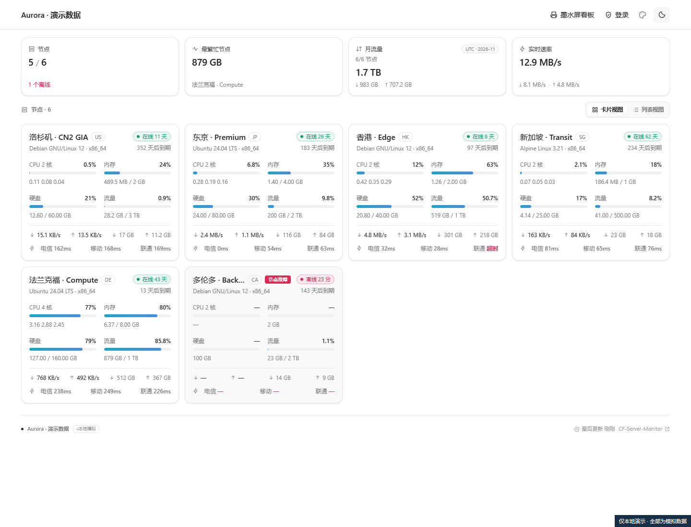
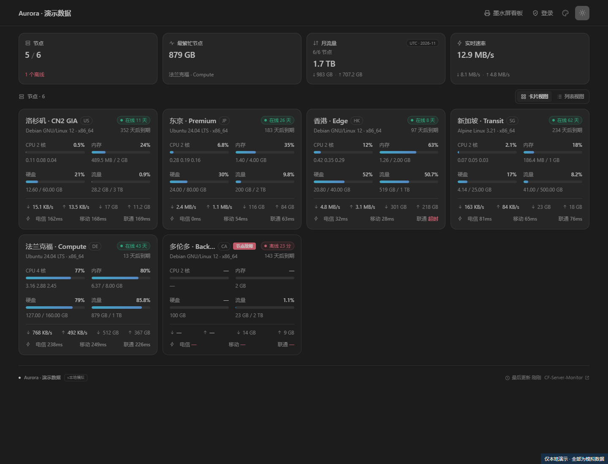
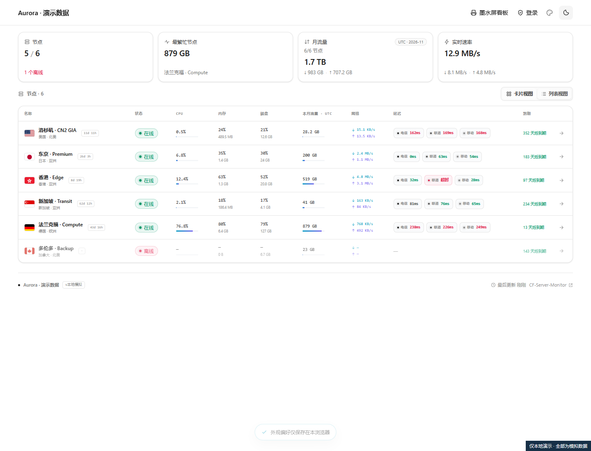
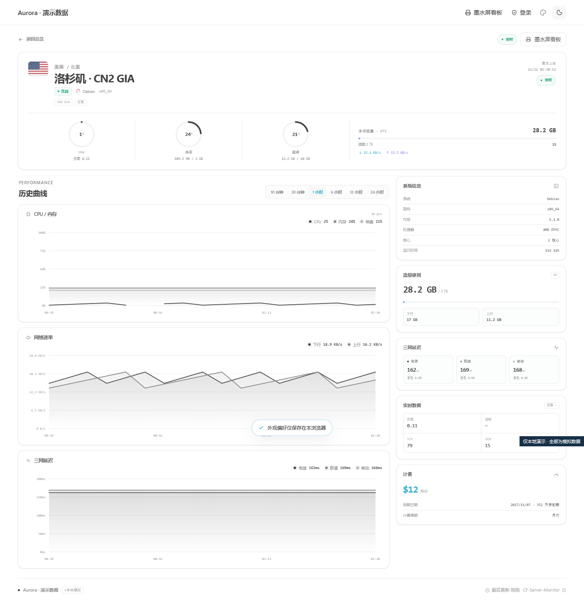
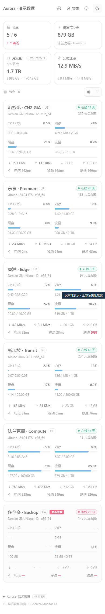

# Aurora · CF-Server-Monitor 主题

为 [CF-Server-Monitor](https://github.com/huilang-me/CF-Server-Monitor) 制作的极光风格第三方前台。保留浅色 / 深色、外观菜单、卡片 / 列表视图和节点历史详情。三网曲线固定为电信紫 / 联通红 / 移动绿，资源曲线为 CPU 紫 / 内存红 / 磁盘绿。

> **验证状态：本地修复已完成。** 每个主题的 97 项自动化测试通过，Vite 发布构建成功，根目录入口和哈希资源已同步；并已使用本地模拟数据完成桌面 / 手机及正常 / 异常交互检查。未进行真实 Cloudflare 站点端到端验收；安装后请先使用管理员预览确认。详细记录见 [docs/VALIDATION.md](docs/VALIDATION.md)。

这不是监控后端，也不替换管理后台。正式使用需要已部署的 CF-Server-Monitor 和正常上报的探针。

## 修复后的样式截图

以下截图来自本次重建后的真实页面，使用明确标记的本地模拟数据；不包含真实服务器，也不表示线路认证或测速结果。



<details><summary>深色、列表与详情</summary>







</details>

<details><summary>手机样式</summary>



</details>

## 安装与回滚

### 使用前确认

- 现有监控站点可以正常打开，探针正常上报。
- 使用支持第三方 GitHub tree 主题地址的 CF-Server-Monitor 版本。
- 主题仓库中的入口和资源能被 Worker 读取；主题不提供私有仓库凭证。
- 下方安装地址适用于**完成构建并发布到对应分支后的版本**。

### 在原项目后台启用

1. 打开监控站点的 `/admin#/admin`，使用你实际配置的后台账号密码登录。
2. 进入外观设置 / 主题页面的第三方主题地址输入框。
3. 填入：

   ```text
   https://github.com/XIEBROxzz/cfsm-theme-aurora/tree/main
   ```

4. 先使用管理员主题预览，确认页面、节点、权限和流量数据正确后再应用。
5. 回到首页检查卡片、列表、详情，以及深浅色切换。

本主题的生产 `index.html` 与 `assets/` 位于**仓库根目录**，不是 `source/`，也不是 Iceglass 的 `theme/` 子目录。不要直接照搬 `.../tree/main/theme`。

Worker 会在监控站点同域反代主题静态资源；`/api/*`、`/flags/*`、`/os-icons/*` 和 `/admin#/admin` 仍由原站点处理。安装主题不需要更改 Worker 代码或安装新的探针。

要固定版本，将地址中的 `main` 替换为真实的 40 位提交哈希。恢复默认主题时，进入默认后台清除第三方主题地址或切换回默认主题；不要通过删除数据库回滚。

## 功能与数据口径

| 页面 / 功能 | 说明 |
| --- | --- |
| `/#/` | 节点概况、实时速率、UTC 月流量、卡片和列表 |
| `/#/server/:id` | 单台节点指标、历史查询和网络质量 |
| 外观菜单 | 明暗、主题色、密度、迷你走势、语言等本机偏好 |
| `/admin#/admin` | 原项目默认后台，不由 Aurora 实现 |

### UTC 自然月流量

与 Iceglass 相同，主题只把以下节点计入 UTC 月度统计：

- 探针配置返回 `reset_day = 1`。
- 最近上报属于当前 UTC 月，并且没有异常未来时间。
- 本月上传、下载计数有效且非负；真实的 `0` 是有效值。

采用 `net_rx_monthly` / `net_tx_monthly`，单位为字节；不使用 `net_rx` / `net_tx` 冒充月流量。自然月范围是每月 1 日 `00:00 UTC` 到下月 1 日 `00:00 UTC` 前，与浏览器时区无关。

- 总览上下行及双向合计按合格节点相加，包含仍有本月有效上报的离线节点。
- 页面标明 UTC 月份、已计入数量与未计入提示。
- 卡片、列表和详情中的无法确认数据显示不可用或具体原因，不伪造零流量。
- 配额使用 `traffic_calc_type`：`total` 双向、`dl` 下载、`ul` 上传、`max` 取较大值。配额分子和百分比使用同一口径；图形长度限幅不应掩盖实际超额数字。

重置日不是 1 号时，主题无法只靠现有周期累计恢复 UTC 自然月。请由管理员在原项目设置中调整，并确认探针实际生效。主题不修改重置设置；月中安装、重装、手动校正或缺失历史都可能使当月计数不完整，不作为精确账单凭证。

### 零值、超时和资源单位

- 内存 / 磁盘容量按接口 MB 数值转换为字节后显示，比例使用原单位计算。
- 实时网速是字节每秒速率，不是 Mbps 带宽测速；离线节点不应继续计入实时速率汇总。
- 延迟 `0 ms` 有效，`null` 表示超时，`false` 或缺失表示未配置 / 未取样。
- 运营商名称读取配置，不根据名称推断线路。
- 分组和标签来自后台设定，不是自动识别 CN2 GIA、双栈或商业带宽的证明。
- 历史曲线仅使用接口返回的真实采样，不用最近点填满缺口。

## 权限与连接

- 只支持**一个同源根地址后端**；跨源、多 `apiBase`、带路径或凭证的 API 地址会明确拒绝。
- 默认无需 `API_BASE`。不要把主题独立放到 GitHub Pages 后期待它自动连接远端监控后端。
- 配置请求匿名发送，不附带登录 Cookie 或 JWT，以避免原项目的登录态配置请求触发远程版本查询。
- 数据请求使用同源现有凭证；私有站点是否允许访问以实际数据接口结果为准，不因匿名配置中的 `authorization=false` 自动跳走。
- 401 / 403 显示错误及默认后台入口。请在 `/admin#/admin` 登录或完成验证，再返回页面刷新；主题不另写登录页或绕过人机验证。
- 外观菜单改动**只保存在当前浏览器**，不再自动写入 `/api/theme_options`，不会改变其他访客偏好。
- 同源 WebSocket 依赖 Cookie，不把 JWT 放入 URL。列表发送节点 ID 过滤，详情只获取并订阅当前节点。
- 隐藏页面暂停传输，重新可见后补读当前页面数据；达到站点连接时限后必须显式继续，路由切换和隐藏 / 显示不能解除暂停。
- WebSocket 不可用时定时刷新；超过 500 台采用明确的轮询，不悄悄截断节点。

## 开发、测试与构建

需要 Node.js **20.19+ 或 22.12+**，以及 npm。仅启用仓库中已构建的主题时，不需要在服务器安装这些工具。

```sh
cd source
npm ci --ignore-scripts
npm test
npm run build:theme
```

- `npm test`：运行只读客户端、UTC 月度、格式与 HTTP 凭证 / 错误处理回归测试；当前 **96 项通过**。
- `npm run build`：只生成 `source/dist/`。
- `npm run build:theme`：Vite 成功后，将 `dist/index.html` 与 `dist/assets/` 同步到仓库根目录，并清理被替代的 JS/CSS 产物。构建失败不更新根目录。
- 必须同时提交源代码和成功构建后的根目录入口、哈希资源；不要只修改编译包，也不要手动重命名哈希文件。

### 无需真实后端的本地演示

在仓库根目录执行：

```sh
node source/scripts/demo.mjs
```

然后打开 `http://127.0.0.1:4179/`。本地服务直接使用仓库根目录已构建的入口 / 资源，只返回内置模拟节点和历史样本，页面明确标注“全部为模拟数据”，不读取真实服务器、Cookie 或远程后端，也不进行后台写入。服务仅监听本机；可通过 `PORT` 环境变量更换端口，按 `Ctrl+C` 停止。

如果要先修改源码，可执行 `npm run build:theme` 更新产物，再运行 `npm run demo`（在 `source/` 内）。演示服务器不是生产后端，不要部署成正式监控 API。

### 连接已授权本地后端进行开发

在 `source/.env.local` 配置你授权使用的**本地后端**：

```dotenv
VITE_DEV_PROXY_TARGET=http://127.0.0.1:8787
```

然后运行：

```sh
npm run dev
```

Vite 将 `/api`、`/flags`、`/os-icons` 代理到该后端。页面仍按同源方式请求；没有后端时，应显示加载错误，不自动生成假节点。不要提交 `.env.local`、访问令牌或真实服务器资料。

## 目录

```text
index.html              # 已同步的生产入口
assets/                 # 已发布哈希资源；与入口一起更新
source/
  src/                  # Vue 组件、只读接入、指标格式化
  test/                 # 客户端、UTC 月流量及格式回归用例
  scripts/              # 构建同步与本地模拟演示
  package.json
  package-lock.json
  vite.config.js
docs/                   # 修复后截图、验证报告
README.md
```

## 已知边界和上线检查

- 本次源码基于上游公开主题协议及 Iceglass 的只读客户端实现；没有在真实 Cloudflare 站点做端到端验收。
- 当前 README 截图已用本次构建产物重新生成，数据为本地模拟样本。
- 主题不提供管理页、测速、自动路由识别或历史流量回补。
- 配置变更后应刷新页面；浏览器缓存的旧哈希资源可能暂时保持旧界面。
- 上线前需检查：首页、卡片 / 列表、直达详情、历史区间、手机溢出、后台入口、验证失败恢复、UTC 月界和时限暂停。
- 不声称某个旧 Beta 版本已验证，也不把默认初始密码说明成永远有效的后台密码。

保留 `Powered by CF-Server-Monitor` 署名。上游代码许可见 [UPSTREAM-LICENSE.txt](UPSTREAM-LICENSE.txt)，Iceglass 共享客户端许可见 [ICEGLASS-LICENSE.txt](ICEGLASS-LICENSE.txt)。
